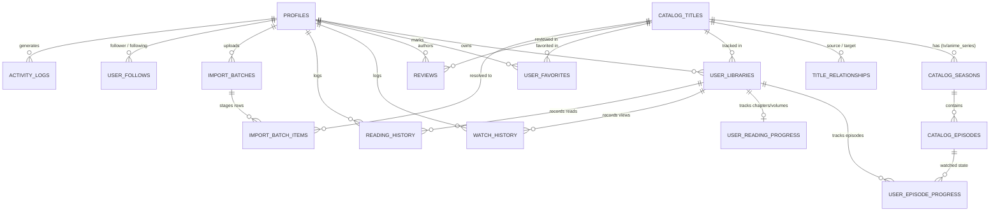

# TrackUp Database Schema & Entity-Relationship Diagram

## 1. Architectural Overview
The TrackUp PostgreSQL schema cleanly decouples shared media catalog metadata from private user libraries and domain-specific tracking mechanics (episodic watch tracking vs chapter reading progress).

## 2. Key Foreign Key Chains
1. **User Identity Chain:** `auth.users` -> `public.profiles` (`id` references `auth.users.id`).
2. **Catalog Hierarchy:** `catalog_titles` -> `catalog_seasons` -> `catalog_episodes`.
3. **Cross-Media Relationships:** `catalog_titles` (source) -> `title_relationships` -> `catalog_titles` (target).
4. **Library & Progress:** `profiles` + `catalog_titles` -> `user_libraries` -> `user_episode_progress` / `user_reading_progress`.
5. **Audit & Activity:** `profiles` -> `watch_history` / `reading_history` / `activity_logs`.
